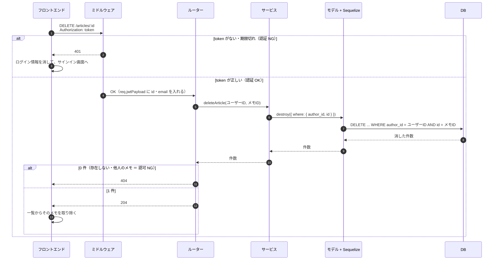

# 開発のまとめ

1日課題「ログイン機能付きメモアプリ」の、開発の進め方・工夫した点・つまずいた点・振り返りをまとめます。

- 画面の仕様は [画面仕様書](screen-spec.md) を参照してください。

## はじめに

開発の経験が少ない中で、わからないなりにも、まずは**最低限動くものを作ること**を一番の目的にしました。
あわせて、どのディレクトリで何をしているのか、フロントエンド・バックエンド・データベースがそれぞれどんな役割で、どうつながっているのか、という**全体の流れを知ること**も目的にしました。

## 1. 開発の進め方

### 1.1 1つの機能の流れ

1. API（バックエンド）を作る → **curl で確認** → commit
2. 画面（フロントエンド）を作る → **ブラウザで確認** → commit
3. push して PR を作成 → マージ → main を最新にする

**やってみて**

- 開発の流れを、実際に手を動かしながら知ることができました。とくに、**バックエンドがないとフロントエンドは作れない（止まってしまう）**ということを実感しました。
- 大変だったのは、画面がない段階で、ターミナルから curl で確認することです。慣れていなかったので、返ってきた結果を読むのに時間がかかりました。

### 1.2 ブランチとコミットのルール

| ブランチの接頭辞 | 使いどころ |
| --- | --- |
| `feature/` | 機能の追加 |
| `fix/` | バグの修正 |
| `chore/` | 環境・設定の変更 |
| `docs/` | ドキュメント |

- **1 つのブランチには、1 つの目的**。途中で別の問題を見つけたら、別のブランチにする
- コミットメッセージには `feat:` / `fix:` / `chore:` / `docs:` を付ける
- PR の説明には「何をしたか／なぜ／どう確認したか」を書く
- マージ済みのコミットは書き換えず、新しいコミットで直す

**やってみて**

- 作業が記録として残るので、後からきちんと見返せるのがよかったです。また、1つのブランチでは1つの機能だけに集中できるので、作業しやすかったです。
- 最初は手順が多そうだと思っていましたが、進めるうちに、こちらのほうが安全でいいと感じるようになり、手順の数は気にならなくなりました。
- ただし、途中の状態でコミットしてしまったり、push のときに入れる予定だった変更が抜けてしまったりしたことがありました。commit・push の前に `git status` と `git diff` で中身を確かめるよう、気をつけたいと思います。

## 2. PR 一覧

| PR | ブランチ | 内容 |
| --- | --- | --- |
| #1 | `chore/gitignore` | .gitignore の作成 |
| #2 | `chore/polling-watch` | Docker 上でファイルの変更を検知できるようにする（`WATCHPACK_POLLING=true`） |
| #3 | `feature/article-list-api` | トークンにユーザー ID を追加、モデルの型の修正、メモ一覧 API |
| #4 | `fix/timezone` | 日時が 9 時間ずれる問題の修正 |
| #5 | `feature/article-list-page` | メモ一覧画面 |
| #6 | `feature/article-delete` | メモ削除（API・画面） |
| #7 | `feature/article-create` | メモ新規作成（API・画面） |
| #8 | `feature/article-edit` | メモ編集（API・画面）、フォームと入力チェックの共通化 |
| #9 | `feature/keep-login` | リロード後もログイン状態を保持 |
| #10 | `feature/ui-design` | 画面デザインの整備 |
| #11 | `docs/screen-spec` | 画面仕様書 |
| #12 | `docs/development` | 開発のまとめ（このファイル） |

#8 のマージで、必須要件がすべてそろいました（MVP 完成）。

## 3. 工夫した点

### 3.1 他人のメモを操作できないようにした

後々ユーザー登録を作って、複数人で使えるようにしたいと考えていました。そのときに、メモをきちんと管理していないと、他人のメモを勝手に消せてしまう、ということが起きてしまいます。そこで、基本的には**自分のメモ以外は操作できないように**しました。

- ログインの確認（**誰か**）は、ミドルウェアで token から行う（認証）
- 操作していいかどうか（**自分のメモか**）は、サービスで、取得・更新・削除のすべてに「作成者（`author_id`）が自分であること」を条件に入れて判断する（認可）
- ユーザー ID は、画面から受け取らず、必ずサーバー側で token から取り出す
- 他人のメモは「存在しない」と同じ扱い（404）にする

### 3.2 開発の流れと、PR の書き方を意識した

今回は、**開発の流れと、機能を増やしていくときの流れ**を特に意識しました。

1つの機能ごとにブランチを作ってコミットし、PR を作るときには、「**何をしたか・なぜしたか・どうやって確認したか**」（必要なら「既知の問題」など）の形で書くようにしました。こう書くことで、**自分の頭の整理**にもなりますし、**他の人が見てもわかる**ようになります。記録を残して、人に伝わるように書くことの意味を知ることができました。

### 3.3 そのほかに入れたもの

- 入力チェックを、画面とサーバーの両方で行った（空白だけも不可）。サーバー側のチェックは共通の関数にまとめた
- 「読み込み中」「0件」「エラー」を区別して表示した
- リロードしてもログインを保持した（読み込みが終わってから、ログイン状態を判定する）
- 新規作成と編集で、同じフォームを使い回した
- ボタンや入力欄の見た目は、`globals.css` にまとめた

## 4. つまずいた点と学んだこと

### 4.1 難しかったこと

一番大変だったのは、**サービスとルーターを作った後の、ターミナルでのテスト**です。curl を使うのは初めてで、コマンドの打ち方も、返ってきた結果の読み方も慣れていなかったので、時間がかかりました。

また、Docker 上でファイルの変更を検知するための**ポーリング**の設定は、AI に教えてもらって初めて、その必要性に気づき、知ることができました。

### 4.2 つまずいたときの進め方

つまずいたときは、基本的に次の流れで進めました。

1. AI に、**つまずいている部分**と、**何をしたいのか**を伝える
2. AI に解決策を提示してもらう
3. 提示された内容を確認する
4. 自分で実装する

### 4.3 実際に起きたこと

| # | 出来事 | 原因 | 学んだこと |
| --- | --- | --- | --- |
| 1 | `.gitignore` の PR に、ポーリングの設定変更が混ざった | 別の作業を、同じブランチで進めてしまった | マージ済みの履歴は書き換えず、別のブランチ（#2）で直し、PR に経緯を書いた。commit の前に `git diff` で中身を確認する |
| 2 | ポーリングの設定が効いていなかった | `=true` が抜けていた | 設定は「書いた」だけでなく、実際に効いているかを確かめる |
| 3 | 日時が 9 時間ずれた | DB は日本時間、API は UTC として読んでいた | 読むときと書くときの、両方のタイムゾーンをそろえる |
| 4 | テスト用のメモが重複した | INSERT を 2 回実行した | テストデータを入れたら、件数も確認する |
| 5 | `git diff` に何も表示されなかった | すでに `git add` していた | add 済みの変更は `git diff --cached` で見る |
| 6 | 手元の main が、GitHub より遅れていた | マージ後の `git pull` を忘れた | マージの後は、必ず `git pull` で main を最新にしてから、次のブランチを作る |
| 7 | 型チェックで、身に覚えのないエラーが出た | 練習用の別のフォルダで実行していた | コマンドを打つ前に、今どのフォルダにいるかを確認する |
| 8 | ヘッダーで型エラー（`never`）が出た | コードを置き換えずに、入れ子で貼り付けた | commit の前に型チェックを実行する。型チェックがミスを見つけてくれる |

## 5. 練習と本番

本番の前に、同じ課題で一度練習しました。

### 5.1 練習してよかったこと

最初に比べて、開発の流れがわかるようになったので、「**次はこの作業だな**」と、先を考えながら進められるようになりました。

本番でも、練習とは違うところでつまずくことはありました。ただ、その多くはケアレスミスで、**落ち着いて見直すと自分でわかる箇所**が増えたと感じています。

### 5.2 まだ難しいこと

他の部分もそうですが、特に curl は、まだ自分で一から書くことはできませんし、詳しく何をしているのかも、まだ十分には理解できていません。
そこから理解しようとすると時間がかかり、アプリを動かすところまで進めなくなりそうだったので、今回は**「最低限動くものを作る」ことを優先して、理解は後回し**にしました。

## 6. AI の使い方

今回は、AI を使いながら開発しました。

### 6.1 意識したこと・ルール

- **コマンドやコードは、自分で打つ**。AI に任せきりにせず、実際に自分でやってみる
- **push などの前に、AI にレビューしてもらう**。間違いがあればさらに直し、問題がなければ push する
- **何を作るか、どこまでやるかは、自分で決める**。AI には、進め方やコードの案を出してもらい、内容を確認してから実装する
- **わからないところは、その場で質問する**（例：Authorization ヘッダーとは何か、モデルは何をしているのか）

AI の案や確認結果も、そのまま信じるのではなく、curl・ブラウザ・型チェックで、自分でも動きを確かめるようにしました。

### 6.2 やってみて

時間がない中でしたが、このやり方で最低限動くものを作ることができたので、AI を活用してよかったと思っています。
一方で、コードの多くは AI の案をもとにしているので、何をしているかは理解していても、「なぜこの書き方なのか」までは、まだ説明しきれないところがあります。
これからは、作業してきたものをきちんと振り返って理解し、自分の知識にしていきたいです。

## 7. 振り返り

知らないことが大半だったので、ほぼすべてが大変でしたが、それも楽しいと感じました。

この課題を通して、**アプリ開発の流れ**や**作業の進め方**を知ることができたのは、とてもよかったです。
つまずくこともありましたが、エラー文を読んで「ここかな」と直して、それで動いたときは、何より楽しかったです。

## 8. 今後やりたいこと

- 今回追加しきれなかった機能を実装する
  - ユーザー登録
  - パスワードの保存方法を、SHA-256 から bcrypt に変える
- 処理の流れや、それぞれの役割・関係性をもっと知り、**「なぜこう書いているのか」「なぜこの処理をしているのか」を説明できる**ようにする