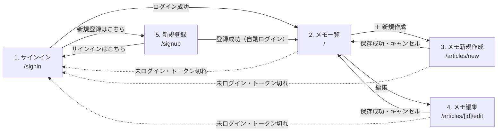

# 画面仕様書

ログイン機能付きメモアプリ（Next.js + Express.js）の画面仕様です。

## 1. 画面一覧

| No | 画面名 | URL | ログイン | 概要 |
| --- | --- | --- | --- | --- |
| 1 | サインイン | `/signin` | 不要 | メールアドレス・パスワードでログインする |
| 5 | 新規登録 | `/signup` | 不要 | ユーザーを新規登録し、そのままログインする |
| 2 | メモ一覧 | `/` | 必要 | ログインユーザーのメモを一覧表示・削除する |
| 3 | メモ新規作成 | `/articles/new` | 必要 | メモを新しく作成する |
| 4 | メモ編集 | `/articles/[id]/edit` | 必要 | 作成済みのメモを編集する |

## 2. 画面遷移図

- 未ログインのときは、ヘッダーの「サインイン」ボタンから、どの画面からでも 1 に移動できる
- ヘッダーのロゴ「メモアプリ」から、どの画面からでも 2 に移動できる

## 3. 共通仕様

### 3.1 ヘッダー（全画面共通）

| No | 項目 | 種類 | 表示条件 | 動作 |
| --- | --- | --- | --- | --- |
| 1 | メモアプリ（ロゴ） | リンク | 常に表示 | メモ一覧（`/`）へ移動 |
| 2 | ○○ さん | テキスト | ログイン中 | ログインユーザーのユーザー名を表示 |
| 3 | ログアウト | ボタン | ログイン中 | ログイン情報を破棄し、メモ一覧へ移動（未ログインのため、サインインへ移動する） |
| 4 | サインイン | ボタン | 未ログイン | サインイン（`/signin`）へ移動 |
| 5 | 新規登録 | ボタン | 未ログイン | 新規登録（`/signup`）へ移動 |

- 2〜5 は、ログイン情報の読み込みが終わってから表示する（リロード時に、一瞬「サインイン」と表示されないようにするため）

### 3.2 ログイン状態の管理

- ログイン成功時に、API から受け取ったログイン情報（id・name・email・token）を保持する
- ログイン情報は React Context と localStorage（キー：`loginData`）の両方に保存し、リロード後もログイン状態を維持する
- ログインが必要な画面（2・3・4）は、localStorage の読み込みが終わってから、未ログインかどうかを判定する
- 未ログインの場合は、サインイン（`/signin`）へ移動する
- ログイン済みでサインイン（`/signin`）・新規登録（`/signup`）を開いた場合は、メモ一覧（`/`）へ移動する（localStorage の読み込みが終わってから判定する）

### 3.3 認証・エラー時の共通動作

- ログインが必要な API には、`Authorization` ヘッダーにトークンを付けてリクエストする
- トークンの有効期限は 10 分
- API が 401（トークンが無効・期限切れ）を返した場合は、ログイン情報を破棄してサインインへ移動する
- API に接続できない場合は、「サーバーに接続できませんでした。」を表示する
- メモの取得・更新・削除は、ログインユーザーが作成したメモのみを対象とする（他人のメモは 404）

### 3.4 共通デザイン

- 色・ボタン・入力欄・カードなどの共通のスタイルは、`globals.css` にまとめて定義する
- ボタンは、主な操作（新規作成・保存・サインイン）を青、通常の操作（編集・キャンセル・ログアウト）を白、取り消せない操作（削除）を赤で表示する
- ページの幅は最大 760px で、中央に表示する

## 4. 各画面の仕様

### 4.1 サインイン（`/signin`）

**概要**：登録済みのメールアドレス・パスワードでログインする。

| No | 項目 | 種類 | 必須 | 入力チェック | 備考 |
| --- | --- | --- | --- | --- | --- |
| 1 | メールアドレス | メール入力 | － | メールアドレス形式（ブラウザの標準チェック） | |
| 2 | パスワード | パスワード入力 | － | なし | 入力内容は伏せ字で表示 |
| 3 | サインイン | ボタン | － | － | |

| 操作 | 動作 |
| --- | --- |
| サインインボタン押下 | `POST /auth/signin` を呼び出す |
| ログイン成功 | ログイン情報を保存し、メモ一覧へ移動 |
| 送信中 | ボタンを「サインイン中...」と表示し、押せない（二重送信防止） |
| ログイン失敗 | 「メールアドレスまたはパスワードが正しくありません。」を表示し、パスワードをクリアする（メールアドレスは残す） |
| API に接続できない | 「サーバーに接続できませんでした。」を表示 |

### 4.2 メモ一覧（`/`）

**概要**：ログインユーザーのメモを、更新日時の新しい順に一覧表示する。各メモの編集・削除ができる。

| No | 項目 | 種類 | 備考 |
| --- | --- | --- | --- |
| 1 | ＋ 新規作成 | ボタン | メモ新規作成（`/articles/new`）へ移動 |
| 2 | タイトル | テキスト | メモごとに表示 |
| 3 | 本文 | テキスト | 改行をそのまま表示する。3 行を超える場合は「…」で省略する |
| 4 | 更新日時・作成日時 | テキスト | 日本時間で表示 |
| 5 | 編集 | ボタン | メモ編集（`/articles/[id]/edit`）へ移動 |
| 6 | 削除 | ボタン | メモを削除する |

| 状態・操作 | 動作 |
| --- | --- |
| 画面表示時 | `GET /articles` を呼び出し、メモ一覧を取得する |
| 取得中 | 「読み込み中...」を表示 |
| メモが 0 件 | 「メモがありません。」「「＋ 新規作成」から、最初のメモを作りましょう。」を表示 |
| 取得失敗（401 以外のエラー） | 「メモの取得に失敗しました。」を表示 |
| API に接続できない | 「サーバーに接続できませんでした。」を表示 |
| 削除ボタン押下 | 確認ダイアログ「このメモを削除しますか？」を表示 |
| 確認で OK | `DELETE /articles/:id` を呼び出し、成功したら一覧からそのメモを取り除く |
| 確認でキャンセル | 何もしない |
| 削除失敗 | アラート「削除に失敗しました。」を表示 |

### 4.3 メモ新規作成（`/articles/new`）

**概要**：タイトル・本文を入力して、メモを新しく作成する。

| No | 項目 | 種類 | 必須 | 入力チェック | エラーメッセージ |
| --- | --- | --- | --- | --- | --- |
| 1 | タイトル | テキスト入力 | ○ | 空白だけは不可、255 文字以内 | タイトルを入力してください。／タイトルは255文字以内で入力してください。 |
| 2 | 本文 | 複数行テキスト入力 | ○ | 空白だけは不可 | 本文を入力してください。 |
| 3 | キャンセル | ボタン | － | － | メモ一覧へ戻る（保存しない） |
| 4 | 保存 | ボタン | － | － | 送信中は「保存中...」と表示し、押せない（二重送信防止） |

| 操作 | 動作 |
| --- | --- |
| 保存ボタン押下 | 入力チェック後、`POST /articles` を呼び出す |
| 入力エラー | 各入力欄の下に、エラーメッセージを赤で表示 |
| 保存成功 | メモ一覧へ移動（作成したメモが先頭に表示される） |
| 保存失敗 | アラート「保存に失敗しました。」を表示 |

※ 入力チェックは、画面（使う人への案内）とサーバー（安全のため）の両方で行う。

### 4.4 メモ編集（`/articles/[id]/edit`）

**概要**：作成済みのメモのタイトル・本文を編集する。入力項目・入力チェックは、メモ新規作成と同じ（同じフォーム部品を使用）。

| 状態・操作 | 動作 |
| --- | --- |
| 画面表示時 | `GET /articles/:id` を呼び出し、今のタイトル・本文をフォームに設定する |
| メモが存在しない・他人のメモ | アラート「メモが見つかりませんでした。」を表示し、メモ一覧へ移動 |
| 保存ボタン押下 | 入力チェック後、`PUT /articles/:id` を呼び出す |
| 保存成功 | メモ一覧へ移動（更新日時が新しくなるため、先頭に表示される） |
| 保存失敗 | アラート「保存に失敗しました。」を表示 |

### 4.5 新規登録（`/signup`）

**概要**：ユーザー名・メールアドレス・パスワードを入力してユーザーを登録し、そのままログインする。

| No | 項目 | 種類 | 必須 | 入力チェック | エラーメッセージ |
| --- | --- | --- | --- | --- | --- |
| 1 | ユーザー名 | テキスト入力 | ○ | 空白だけは不可、255 文字以内 | ユーザー名を入力してください。／ユーザー名は255文字以内で入力してください。 |
| 2 | メールアドレス | メール入力 | ○ | メールアドレス形式、255 文字以内 | メールアドレスを入力してください。 |
| 3 | パスワード | パスワード入力 | ○ | 8 文字以上 | パスワードは8文字以上で入力してください。 |
| 4 | パスワード（確認） | パスワード入力 | ○ | パスワードと一致 | パスワードが一致しません。 |
| 5 | 登録する | ボタン | － | － | 送信中は「登録中...」と表示し、押せない |
| 6 | サインイン | リンク | － | － | サインイン（`/signin`）へ移動 |

| 操作 | 動作 |
| --- | --- |
| 登録ボタン押下 | 入力チェック後、`POST /users` を呼び出す |
| 登録成功 | ログイン情報を保存し、メモ一覧へ移動 |
| メールアドレスが登録済み | 「このメールアドレスは既に登録されています。」を表示 |
| 入力不正（サーバー側チェック） | API が返すメッセージを表示 |
| API に接続できない | 「サーバーに接続できませんでした。」を表示 |

## 5. 使用 API 一覧

| メソッド | URL | 認証 | 概要 | 主なレスポンス |
| --- | --- | --- | --- | --- |
| POST | `/auth/signin` | 不要 | ログイン（`email`・`password` の両方が必要） | 200（成功時は id・name・email・token、失敗時は空） |
| POST | `/users` | 不要 | ユーザー新規登録 | 201（id・name・email・token）／400（入力不正）／409（メールアドレス重複） |
| GET | `/articles` | 必要 | ログインユーザーのメモ一覧取得（更新日時の新しい順） | 200 |
| POST | `/articles` | 必要 | メモ新規登録 | 201／400（入力不正） |
| GET | `/articles/:id` | 必要 | メモ 1 件取得 | 200／404 |
| PUT | `/articles/:id` | 必要 | メモ更新 | 200（更新後のメモ）／400（入力不正）／404 |
| DELETE | `/articles/:id` | 必要 | メモ削除 | 204／404 |

- 認証が必要な API は、トークンがない・無効な場合に 401 を返す
- トークンの中身は `{ id, email }`。ユーザーの特定は、必ずサーバー側でトークンから行う（クライアントからユーザー ID を受け取らない）

## 6. 課題・今後の改善

| 区分 | 内容 |
| --- | --- |
| セキュリティ | パスワードがSHA-256 で保存されている |
| セキュリティ | トークンを localStorage に保存しているため、XSS に弱い |
| 使い勝手 | トークンの有効期限が 10 分と短い |